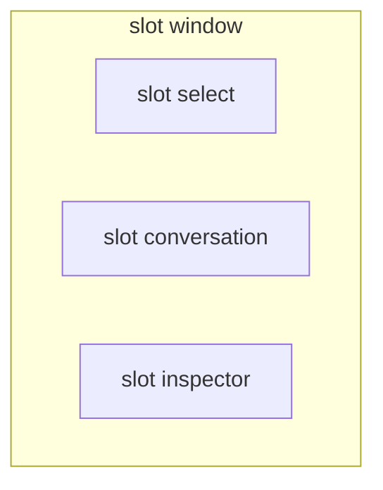
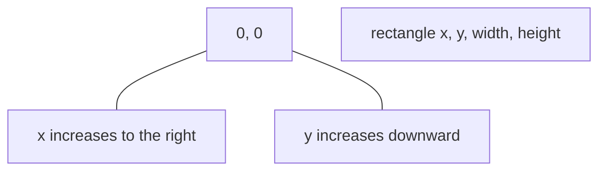
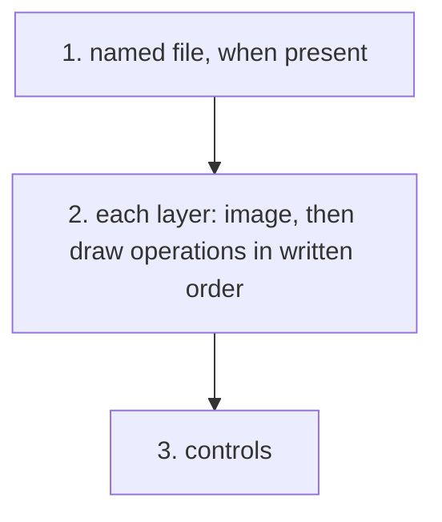

# Skins

A skin is a directory of drawing instructions for the lonchan window. The program reads that directory, turns the instructions into rectangles, circles, lines, regular polygons, and images, and places the controls on top.

A skin can also restyle the controls themselves: text and button colors, field and button shapes, sizes, fonts, and icons, for the whole window or for one pane.

The sections below give the directory layout, the four frames the window paints, the coordinate system, the `skin.json` fields, colors, control styling, slot styling, image files, nine-slice borders, vector operations, paint order, content rectangles, the built-in skin `plain`, a composition procedure, and a complete example.

## Skin Storage

The configuration directory is the path returned by `os.UserConfigDir` with `lonchan` appended. On Windows that is `%AppData%\lonchan`. A folder named `lonchaney` is used when `lonchan` is not there yet.

Each skin is one subdirectory:

```text
%AppData%\lonchan\skins\<id>\
    skin.json
    window.svg
    conversation.png
    …
```

`<id>` is the directory name. That name is the value stored in `config.skin`, and it is the name shown in Settings → Skins. The built-in skin is named `plain`. The program constructs it in memory.

Settings → Skins lists `plain` and every subdirectory of `skins`. Choosing a name writes `config.skin` and rebuilds the chat window. **Add** copies a chosen folder into `skins\<folder name>\`. The copy includes `skin.json` and any images that were in the source folder.

A pane may name a different skin in its `skinID` field. The Layout screen calls that control **Skin**. The choice `window default` stores an empty `skinID`, and the pane uses `config.skin`. Any other directory name loads `skins\<that name>\` for that pane. A `skinID` of `plain` is read as an empty `skinID`, so the pane uses the window skin.

If `skin.json` is absent, the directory loads with the directory name as the pack name and with `panes` as an empty object. Image files named after a slot are drawn. If `skin.json` is present and is invalid JSON, the load fails. A failed window skin is replaced by `plain`. A failed pane skin leaves that pane on the window skin.

## Window Drawing Operations

The painter builds a frame for four slot names:

| Slot | Where it is drawn |
| --- | --- |
| `window` | Behind the whole chat window, including the splits. |
| `conversation` | Behind a pane whose mounted context has kind `conversation`. |
| `select` | Behind a pane whose mounted context has kind `select`. |
| `inspector` | Behind a pane whose mounted context has kind `inspector`. |
| `panes` | Behind a pane whose mounted context has kind `panes` (the Panes list), and behind the separate Panes window. A skin with no `panes` slot draws the `inspector` slot there instead. |

`config.skin` supplies those five frames. A pane `skinID` supplies the pack for that pane’s frame. The `window` frame comes from `config.skin`.

The Skins screen also prints a line for every name returned by `skin.Slots`:

```text
window
conversation
conversation-header
conversation-transcript
conversation-composer
select
select-section
select-row
panes
inspector
settings
settings-nav
settings-row
suite
suite-tool
handle
```

Those lines report the image path, the layer count, and the number of `content` entries. The window builds a frame for `window`, `conversation`, `select`, and `inspector`. The settings window is a split of a navigation list and a section, painted with `settings-nav` and `settings`. Each split handle is painted with `handle`. When the skin draws nothing for `handle`, the handle is a strip of the `separator` color. The suite popup and a selection row are widgets. The header, the transcript, and the composer are controls inside the `conversation` frame. Their rectangles are specified under Content Rectangles.



On first launch the outer split is 10 percent selection and 90 percent the rest, and the inner split gives the conversation 80/90 of that rest. Each of those three panes is one frame. The `window` frame is behind all three. A skin’s coordinates are fractions of the frame being painted. The same `conversation` description is applied at the pixel size the splits give that pane.

## Frame Coordinates

Every rectangle in `skin.json` is four numbers:

```text
[x, y, width, height]
```

The origin is the top-left corner of the current frame. `x` and `width` are fractions of the frame’s current width. `y` and `height` are fractions of the frame’s current height. `width` extends to the right from `x`. `height` extends downward from `y`.

A value of `0.10` is one tenth of that side. The rectangle `[0.04, 0.12, 0.92, 0.68]` on a frame that is 1000 pixels wide and 800 pixels tall is placed at

```text
x      = 0.04 × 1000 = 40
y      = 0.12 × 800  = 96
width  = 0.92 × 1000 = 920
height = 0.68 × 800  = 544
```

The same JSON on a frame that is 200 pixels wide and 600 pixels tall becomes `x = 8`, `y = 72`, `width = 184`, `height = 408`.

If a rectangle has fewer than four numbers, the painter uses `[0, 0, 1, 1]`, which is the entire frame.

`radius` and `strokeWidth` are fractions of the shorter side of the frame. On a 1000 by 800 frame the shorter side is 800. `radius: 0.01` is 8 pixels. `strokeWidth: 0.005` is 4 pixels.

A line’s `from` and `to` are two numbers each, `[x, y]`, in the same frame fractions.



## skin.json Fields

The file is a JSON object with these fields. Only `panes` is needed.

| Field | Type | Meaning |
| --- | --- | --- |
| `name` | string | A label stored in the file. Settings → Skins selects the directory name. |
| `palette` | object | Named colors. The key is a name, the value is `#RRGGBB` or `#RRGGBBAA`. Draw operations and theme colors may use the name. See Color Values. |
| `theme` | object | Restyles the controls everywhere: text, buttons, fields, menus, sizes, fonts, and icons. See Control Styling. |
| `panes` | object | One entry per slot name. The key is the slot. The value is that slot’s description. |

A slot description has these fields.

| Field | Type | Meaning |
| --- | --- | --- |
| `layers` | array | Images and draw operations, read from first to last. |
| `content` | object | Named rectangles for the conversation controls `header`, `transcript`, and `composer`. |
| `theme` | object | Restyles the controls inside this slot only. See Slot Styling. |

A layer has these fields. Any field may be omitted.

| Field | Type | Meaning |
| --- | --- | --- |
| `image` | string | A file path. A relative path is joined to the skin directory. |
| `rect` | four numbers | Where that image is placed. An omitted `rect` is the whole frame. |
| `slice` | four numbers | The 9-slice borders of the source image: `[left, top, right, bottom]`. |
| `draw` | array | Vector operations painted with the theme or with a hex color. |

One layer may contain an image, a `draw` array, or both. The painter walks the layers from first to last. In each layer it paints the image, then each draw operation in that array, then the next layer, then the controls. That order is specified under Paint Order.

A draw operation has these fields.

| Field | Used by | Meaning |
| --- | --- | --- |
| `op` | all | `rect`, `ellipse`, `line`, or `polygon`. Any other value, including an empty string, is drawn as `rect`. |
| `rect` | `rect`, `ellipse` | `[x, y, width, height]` in frame fractions. |
| `from`, `to` | `line` | Each is `[x, y]` in frame fractions. |
| `points` | `polygon` | A flat list `[x1, y1, x2, y2, …]`. The count of pairs sets the number of sides. The pairs set the bounding box. |
| `fill` | `rect`, `ellipse`, `polygon` | A theme role, a palette name, `#RRGGBB`, or `#RRGGBBAA`. |
| `stroke` | `rect`, `ellipse`, `line`, `polygon` | A theme role, a palette name, `#RRGGBB`, or `#RRGGBBAA`. |
| `radius` | `rect` | Corner radius, as a fraction of the frame’s shorter side. |
| `strokeWidth` | `rect`, `ellipse`, `line`, `polygon` | Stroke width, as a fraction of the frame’s shorter side. |

## Color Values

`fill` and `stroke` accept four kinds of value. They are tried in this order:

1. A name from the skin’s `palette`. It becomes that entry’s color.
2. `#RRGGBB`, or `#RRGGBBAA` where `AA` is the opacity: `00` is invisible and `FF` is solid.
3. A theme role: any color name listed under Control Styling, such as `foreground`, `primary`, `button`, or `inputBackground`. It takes the current theme color.
4. Anything else is drawn with the foreground color. An empty `fill` is drawn transparent.

A theme role follows the current theme: Settings → Colors, the skin’s `theme` block, and the slot’s `theme` block, as described under Control Styling. A palette name or a hex color stays the written color when the theme changes.

A palette keeps a skin readable. This palette names two colors, and the draw operation uses one of them:

```json
"palette": { "orange": "#FF9900", "glass": "#FFFFFF33" },
…
{ "op": "rect", "rect": [0, 0, 1, 0.02], "fill": "orange" }
```

A palette name that is also a theme role, such as `primary`, hides that role in this skin. Pick names that are not in the list under Control Styling.

## Control Styling

The skin’s drawing sits behind the controls. Text, buttons, fields, checkboxes, menus, and dialogs are drawn by Fyne with the theme. A skin with a black background and the default Light theme draws black text on black. The top-level `theme` block fixes that: it restyles the controls to match the drawing.

```json
"theme": {
  "variant": "dark",
  "colors": {
    "background": "#000000",
    "foreground": "#FFCC99",
    "primary": "orange",
    "foregroundOnPrimary": "#000000",
    "button": "#3D2E5C"
  },
  "sizes": { "inputRadius": 16 },
  "fonts": { "regular": "fonts/Condensed.ttf" },
  "icons": { "mailSend": "icons/send.svg" }
}
```

| Field | Type | Meaning |
| --- | --- | --- |
| `variant` | string | `dark` or `light`. Color names the skin does not set come from Fyne’s built-in dark or light palette. When omitted, the skin’s `background` color decides: a dark background means `dark`. |
| `colors` | object | Color name → palette name, `#RRGGBB`, or `#RRGGBBAA`. |
| `sizes` | object | Size name → pixels. |
| `fonts` | object | `regular`, `bold`, `italic`, `boldItalic`, `monospace`, or `symbol` → a `.ttf` or `.otf` file. A relative path is joined to the skin directory. |
| `icons` | object | A Fyne icon name, such as `mailSend`, `search`, `menu`, or `moreVertical`, → an `.svg` or `.png` file. An SVG icon is recolored with the foreground color, as Fyne’s own icons are. |

### Color names

| Name | What it colors |
| --- | --- |
| `background` | Window and pane backgrounds behind the skin drawing, dialogs |
| `foreground` | Text, icons, and standard button labels |
| `primary` | Primary buttons, checked boxes, sliders, focus accents, unread badges |
| `foregroundOnPrimary` | Text and icons on primary buttons and badges |
| `button` | Standard buttons |
| `disabledButton` | Disabled buttons |
| `disabled` | Disabled text, timestamps, muted hints |
| `placeholder` | Placeholder text in empty fields, secondary text |
| `hover` | Pointer-over highlight |
| `pressed` | Button pressed highlight |
| `focus` | Focus ring on fields and buttons |
| `selection` | Selected text, selected list rows |
| `inputBackground` | Text fields and select boxes |
| `inputBorder` | Text field borders |
| `separator` | Separator lines, message dividers, and split handles that the skin does not draw |
| `scrollBar`, `scrollBarBackground` | Scroll bars |
| `menuBackground` | Menus and pop-up menus |
| `overlayBackground` | Pop-ups and dialogs |
| `headerBackground` | Table and list headers |
| `hyperlink` | Links |
| `shadow` | Shadows under pop-ups and cards |
| `error`, `success`, `warning` | Status colors |
| `foregroundOnError`, `foregroundOnSuccess`, `foregroundOnWarning` | Text on those status colors |

### Size names

| Name | Meaning |
| --- | --- |
| `text` | Body text |
| `headingText`, `subHeadingText`, `captionText` | Page titles, group titles, small text |
| `padding` | Space between controls |
| `innerPadding` | Space inside a control, around its text |
| `inputRadius` | Corner radius of buttons and fields. Half a button’s height makes pills. |
| `selectionRadius` | Corner radius of selection highlights |
| `inputBorder` | Field border width |
| `scrollBar`, `scrollBarSmall` | Scroll bar width, expanded and resting |
| `separator` | Separator line thickness |
| `lineSpacing` | Extra space between lines of text |
| `iconInline` | Icon size inside buttons and fields |

The font scale under Settings → Colors still multiplies `text`, `headingText`, `subHeadingText`, and `captionText`, so a skin that sets text sizes stays usable for someone who needs larger text.

### Settings → Colors and the skin

Each color name is looked up in this order:

1. The skin’s `theme.colors`.
2. When the Settings → Colors preset is **Custom**, the value entered there.
3. When the skin sets a `variant` or a `background`, Fyne’s built-in palette for that variant. Otherwise, the Settings → Colors preset.

So a skin with its own dark look replaces a Light or Dark preset completely. A Custom preset fills in the names the skin leaves out. A font chosen under Settings → Colors wins over the skin’s font for that style.

Settings → Skins shows what the skin restyles under **Control style**. Clear **Use the skin’s colors, sizes, fonts, and icons** to keep the Settings → Colors theme and use only the skin’s drawing. That choice is stored as `ignoreSkinTheme` in the configuration.

## Slot Styling

A slot description may have its own `theme` block with the same fields. It restyles only the controls inside that slot, and the draw operations in that slot that name a theme role. Names it leaves out come from the window theme. A slot block with a `variant` starts from Fyne’s palette for that variant instead.

```json
"inspector": {
  "theme": { "colors": { "foreground": "#CCCCFF", "primary": "#CC99CC" } },
  "layers": [ … ]
}
```

Slot styling applies to `conversation`, `select`, `inspector`, `settings`, and `settings-nav`. Menus, pop-ups, and dialogs opened from a slot use the window theme.

When a pane names a different skin in its `skinID`, that skin’s top-level `theme` block restyles the pane, with the slot’s block over it.

## Image Files

A slot image comes from a file named after the slot, or from a layer’s `image` field.

The named file is `<slot>.svg` or `<slot>.png` in the skin directory. `skin.File` resolves it. When both `conversation.svg` and `conversation.png` exist, the SVG is used. That file is inserted as the bottom image, with rectangle `[0, 0, 1, 1]` and slice borders of zero, when no layer `image` uses the same file name.

A layer `image` field names a file. `conversation.svg` is the file `conversation.svg` inside the skin directory. `frames/border.png` is `frames/border.png` inside that directory. An absolute path is used as written. When that file name matches the named file above, the painter uses the layer’s image once. The match is the file name.

Before a slice is applied, the file becomes a bitmap:

- An `.svg` file is rasterized with `oksvg` and `rasterx` at the pixel size of the rectangle it is being painted into. The SVG view box is mapped onto that rectangle. The raster is cached for that pixel size.
- A `.png` file is decoded at the pixel size stored in the file.

That bitmap is the source for the 9-slice. The destination is the layer rectangle in pixels. The finished image is stretched to that rectangle.

A missing or unreadable image is skipped. The rest of the slot is drawn.

`plain` is built in memory and has no directory. A skin loaded from `skins\<id>\` reads the SVG and PNG files in that directory.

## Nine-Slice Borders

`slice` is `[left, top, right, bottom]`. Each number is a fraction of the source bitmap. `left` is that fraction of the source width, measured from the left edge. `right` is that fraction of the source width, measured from the right edge. `top` is that fraction of the source height, measured from the top edge. `bottom` is that fraction of the source height, measured from the bottom edge.

The source is divided into nine regions: four corners, four edges, and a center. Each corner is copied at its source pixel size. Each edge is stretched along one axis. The center is stretched along both axes.

```text
source bitmap

+--------+----------------------+--------+
|        |                      |        |
|  TL    |         top          |   TR   |
|        |                      |        |
+--------+----------------------+--------+
|        |                      |        |
|  left  |        center        |  right |
|        |                      |        |
+--------+----------------------+--------+
|        |                      |        |
|  BL    |        bottom        |   BR   |
|        |                      |        |
+--------+----------------------+--------+
```

Take a source that is 100 by 100 pixels and a slice of `[0.1, 0.1, 0.1, 0.1]`. Each border is 10 source pixels. When the destination is 200 pixels wide and 100 pixels tall, the left and right borders remain 10 pixels. The top and bottom borders remain 10 pixels. The extra 100 pixels of width go to the top edge, the bottom edge, and the center.

When the destination is smaller than the two opposite borders added together, those borders are scaled down so they fit. A destination 12 pixels wide, with 10-pixel left and right borders, scales those borders by `12 / 20`.

When `slice` is omitted, or has fewer than four numbers, every border is zero. The whole source is the center, and the whole image stretches to the destination rectangle.

The slice is recomputed when the frame’s pixel size changes. The source bitmap is kept. A second paint at the same destination size reuses the previous result.

## Vector Draw Operations

### `rect`

`rect` becomes a Fyne `canvas.Rectangle` filling `rect`.

`fill` is the interior. `stroke` is the border color. When `stroke` is set and `strokeWidth` is omitted or zero, the border is 1 pixel, the width assigned when the rectangle is created. When `strokeWidth` is greater than zero, the width is `strokeWidth` times the frame’s shorter side.

`radius` sets `CornerRadius` to `radius` times the frame’s shorter side. A rectangle with `radius: 0.01` on an 800-pixel short side has an 8-pixel corner radius.

### `ellipse`

`ellipse` becomes a Fyne `canvas.Circle` resized to `rect`. The circle is stretched to that rectangle. A rectangle wider than it is tall produces a wide ellipse. A square produces a circle.

`fill` and `stroke` are applied as they are for a rectangle. `strokeWidth`, when greater than zero, is a fraction of the frame’s shorter side.

### `line`

`line` becomes a Fyne `canvas.Line`. `from` and `to` are converted from frame fractions to pixels. The line object occupies the whole frame, and the two endpoints lie inside it.

The line color is `stroke`. `strokeWidth`, when greater than zero, is a fraction of the frame’s shorter side. When it is zero, the line keeps the Fyne default width.

### `polygon`

`polygon` becomes a Fyne regular polygon (`canvas.Polygon`, which is `canvas.RegularPolygon`).

The number of sides is the number of coordinate pairs in `points`. Fewer than three sides is raised to three, so `[0.2, 0.2]` draws a triangle. The polygon is sized to the bounding box of those pairs. A regular hexagon whose pairs span `x` from 0.10 to 0.40 and `y` from 0.10 to 0.30 is drawn in that box. Moving a single pair moves or resizes the box. The polygon stays regular.

`fill` is the interior. `stroke` is the outline. `strokeWidth`, when greater than zero, is a fraction of the frame’s shorter side.

## Paint Order

Inside one frame the program paints in this order, from back to front:

1. The named file, when it was added, as the bottom image.
2. Each layer, from first to last. Within a layer, the image is painted, then each operation in that layer's `draw` array, in the order written.
3. The controls.

A line in a later layer is painted after a rectangle in an earlier layer. A line that follows a rectangle in the same `draw` array is painted after that rectangle. Controls cover the drawing.



Later items cover earlier ones.

## Content Rectangles

`content` maps a control name to a rectangle. The `conversation` frame places these controls:

| Key | Control |
| --- | --- |
| `header` | The pane header: context, identity, target, Settings. |
| `transcript` | The message list, including `N new` when that button is visible. |
| `composer` | The four-line message entry and the Send button. |

When `conversation.content` includes one or more of those keys, each included key is placed in its rectangle. A map that contains `transcript` and omits `composer` places the transcript. The painter reads `header`, `transcript`, and `composer`.

When `conversation.content` is absent, or when its keys fall outside that list, the conversation uses its border layout: header at the top, composer at the bottom, transcript in the remaining middle. The drawing stays behind that layout.

On `select` and on `inspector`, the pane fills `[0, 0, 1, 1]` of its frame. A `content` map on those slots is stored and counted on the Skins screen.

The child of the `window` frame is the split tree, and that tree fills the frame. A `content` map on `window` is stored and counted on the Skins screen.

## Built-in Skin plain

`plain` is selected on first launch. It has no files. The in-memory document is equivalent to the description below.

`window`, `select`, `inspector`, and `settings` are each one rectangle, `[0, 0, 1, 1]`, filled with `background`. The `settings` rectangle is part of that document. The settings screen is the navigation split.

`conversation` draws two rectangles and then places three controls:

1. `[0, 0, 1, 1]` filled with `background`.
2. `[0.03, 0.12, 0.94, 0.70]` filled with `inputBackground`, with `radius` `0.01`.
3. Header at `[0.02, 0.02, 0.96, 0.08]`.
4. Transcript at `[0.04, 0.12, 0.92, 0.68]`.
5. Composer at `[0.04, 0.82, 0.92, 0.14]`.

On a conversation frame of 1000 by 1000 pixels, the transcript is the rectangle at pixel `(40, 120)` with size `920` by `680`. That is the placement checked by `TestDesktopPass`.

```text
conversation frame, plain

0,0 +--------------------------------------+
    | header          y=0.02  h=0.08      |
    |   +------------------------------+  |
    |   | inputBackground rect         |  |
    |   | transcript  y=0.12  h=0.68   |  |
    |   |                              |  |
    |   +------------------------------+  |
    | composer        y=0.82  h=0.14      |
1,1 +--------------------------------------+
```

The header and the composer sit on the background rectangle. The transcript sits over the `inputBackground` rectangle, inset from it by a small margin.

## Skin Composition

1. Create a directory, for example `%AppData%\lonchan\skins\example\`.
2. Add `skin.json` with a `name` and a `panes` object.
3. Describe `window` for the area behind the splits.
4. Describe `conversation`. Put `header`, `transcript`, and `composer` in `content` when those controls should occupy fixed fractions of the frame. Leave `content` out to keep the border layout: header at the top, composer at the bottom, transcript in the middle.
5. Describe `select` and `inspector` with their own layers.
6. Add `<slot>.svg` or `<slot>.png` for `window`, `conversation`, `select`, or `inspector` when that frame should use a picture. Put a 9-slice on the layer when the picture’s borders should keep their source pixel size.
7. Open Settings → Skins, choose **Add**, and select the directory. A directory created already inside `skins` appears in the list. Choose it. The chat window rebuilds.
8. Read the slot lines under the list. `layers=` is the number of layer objects. `content=` is the number of content keys. `image=` is the path returned by `skin.File` for that slot. That path is empty for `plain`, and empty when the slot has neither an SVG nor a PNG.
9. Drag a split. The fractions are applied to the new pixel size. The corners of a 9-slice keep their source pixel size. When the pane is smaller than those corners, the borders are scaled down as described under Nine-Slice Borders.

A skin sets the drawing behind the controls and, for a conversation, the rectangles occupied by the header, the transcript, and the composer.

## Example Skin

This example is a directory named `example`. It paints a full-window background, a conversation frame with a sliced border image and an inset transcript, and flat panes for selection and the inspector.

Directory:

```text
example\
    skin.json
    conversation.svg
```

`conversation.svg` is a border drawing: opaque pixels near the edges, and an empty center. The slice below keeps 6 percent of the raster on each side. Those corners stay at 6 percent of the rectangle as the conversation pane changes size.

`skin.json`:

```json
{
  "name": "example",
  "panes": {
    "window": {
      "layers": [
        {
          "draw": [
            {
              "op": "rect",
              "rect": [0, 0, 1, 1],
              "fill": "background"
            }
          ]
        }
      ]
    },
    "conversation": {
      "layers": [
        {
          "image": "conversation.svg",
          "rect": [0, 0, 1, 1],
          "slice": [0.06, 0.06, 0.06, 0.06]
        },
        {
          "draw": [
            {
              "op": "rect",
              "rect": [0.04, 0.12, 0.92, 0.66],
              "fill": "inputBackground",
              "radius": 0.01
            },
            {
              "op": "line",
              "from": [0.04, 0.80],
              "to": [0.96, 0.80],
              "stroke": "separator",
              "strokeWidth": 0.002
            },
            {
              "op": "ellipse",
              "rect": [0.90, 0.03, 0.06, 0.06],
              "fill": "primary"
            }
          ]
        }
      ],
      "content": {
        "header": [0.04, 0.02, 0.84, 0.08],
        "transcript": [0.06, 0.14, 0.88, 0.64],
        "composer": [0.04, 0.82, 0.92, 0.14]
      }
    },
    "select": {
      "layers": [
        {
          "draw": [
            {
              "op": "rect",
              "rect": [0, 0, 1, 1],
              "fill": "background",
              "stroke": "separator",
              "strokeWidth": 0.01
            }
          ]
        }
      ]
    },
    "inspector": {
      "layers": [
        {
          "draw": [
            {
              "op": "rect",
              "rect": [0, 0, 1, 1],
              "fill": "background"
            },
            {
              "op": "polygon",
              "points": [0.30, 0.86, 0.70, 0.86, 0.70, 0.96, 0.30, 0.96],
              "fill": "selection",
              "stroke": "primary",
              "strokeWidth": 0.004
            }
          ]
        }
      ]
    }
  }
}
```

Read in paint order, the conversation frame does this:

1. `conversation.svg` is rasterized at the frame's pixel size and 9-sliced across the whole frame. The file name matches the layer’s `image`, so that sliced image is the slot’s image.
2. The `inputBackground` rectangle is drawn from 4 percent in from the left and 12 percent down, at 92 percent of the width and 66 percent of the height, with corners of 1 percent of the shorter side.
3. A horizontal separator is drawn at 80 percent of the height, from 4 percent to 96 percent of the width. Its thickness is 0.2 percent of the shorter side. It follows the `inputBackground` rectangle because it is the next operation in the same `draw` array.
4. A primary-colored ellipse is drawn in a square at the top right. The square is 6 percent of the frame on each side, so the result is a circle. It is the next operation in that `draw` array, so it is painted after the separator.
5. The header, transcript, and composer are placed in the three `content` rectangles and cover the drawing.

The inspector polygon has four pairs, so it is a regular four-sided polygon, a diamond in Fyne’s regular-polygon drawing, sized to the box from `(0.30, 0.86)` to `(0.70, 0.96)`. Filling that box from corner to corner is a `rect`.

The select pane is one stroked rectangle filling the frame. Its `strokeWidth` of `0.01` is 1 percent of the shorter side. On a pane 120 pixels wide and 800 pixels tall, that is 1.2 pixels.

After the directory is installed, Settings → Skins shows `example` in the list. The `conversation` line reports the SVG path, `layers=2`, and `content=3`. The `window` line reports `layers=1` and `content=0`. Names such as `suite` and `handle` report `layers=0` and `content=0` until those keys are added. Adding the keys changes the report. The window draws the four frames listed under Window Drawing Operations.
